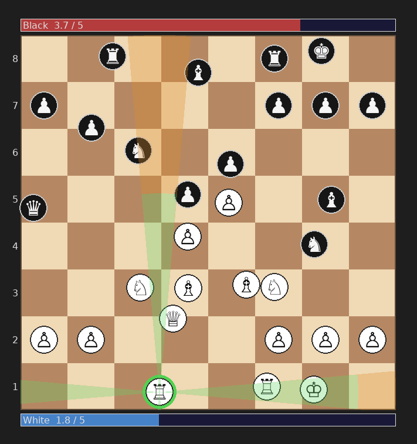

# Continuous Chess

**Play at [continuous-chess.com](https://continuous-chess.com)**

Real-time chess on a continuous board.

- Both players move at once, paying for moves with regenerating mana.
- Pieces can stop anywhere, not just on squares.
- A moving piece captures what it touches.
- No check: capture the king to win.

Rules: [`rules.md`](rules.md). Commands: [`COMMANDS.md`](COMMANDS.md). Architecture: [`docs/architecture.md`](docs/architecture.md).
